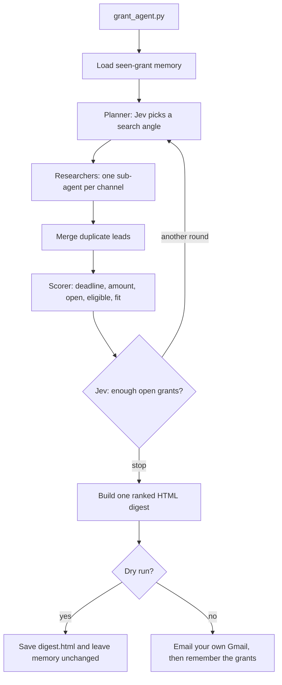

# GrantScout: autonomous research agent

An autonomous research agent that finds nonprofit grants every day, scores how well each one fits, and emails you a ranked digest with deadlines and apply links. Built with Jev and Composio.

One run searches several sources, scores how well each lead fits your nonprofit, and sends **one** HTML email to the Gmail account you connected. The email lists each grant's name, funder, amount, deadline, fit score (0–4), and apply link. When no award amount is identified, the amount cell says "See page" (Grants.gov leads use that placeholder). Grants that clear every check appear under **New grants ready to apply**. A **Needs review** section holds decent fits that missed a check. A **Closing soon** section lists grants from earlier runs whose deadline falls within the next 14 days.

Jev (TypeSafe) answers typed yes/no, choice, and score questions. Python runs the loop, does the date math, builds the email, and enforces the budgets. Composio runs the search, page-fetch, and Gmail tools. Grants.gov is called directly.

## How it works

`grant_agent.py` loads `.env`, checks that `COMPOSIO_API_KEY` and `TYPESAFE_API_KEY` are set, and loads the seen-grant memory. It then hands the run to the coordinator and, after scoring, builds the digest.

Three roles in `grant_agent/agents.py` make up the agent loop:

- **Planner.** `coordinator` runs up to three rounds. Each round asks Jev which unused search angle to try next (`pick_angle`). After that round is scored, it asks Jev whether there are already enough good open grants to stop (`enough`). The loop also stops when no angles are left, when the shared Jev budget is spent, or when Jev's stop probability is at least 0.5.
- **Researchers.** One `sub_agent` per channel runs in parallel. Each researcher has its own loop: issue a query, drop links already seen in this run or in memory, ask Jev whether each remaining hit is one specific grant (`is_grant`, keep at 0.70 or above), then ask whether another query on that channel is likely to help (`dig_deeper`, stop that channel below 0.50). On the Tavily and DuckDuckGo channels, when that channel still has more than three Jev calls left, the researcher also calls Exa find-similar on its best hit.
- **Scorer.** `verify_and_score` reads the page (Grants.gov leads already include a deadline and funder, so they skip the fetch). Python extracts future dates and dollar amounts. Jev says which date is the application deadline, which amount is the award size, and whether the grant is open, eligible for a small US 501(c)(3), and how well it fits the profile in `config.py`. `route` turns those numbers into a decision.

A lead is filed as **Open** when the fit score is at least 2.0 and the checks all clear: deadline confidence ≥ 0.60, fit confidence ≥ 0.45, eligibility ≥ 0.60, and open ≥ 0.50. A lead with a fit score of at least 1.5 that misses one of those checks is **Needs review**. A lead with no fit confidence, no future deadline, an unreadable page, or a spent page-fetch budget is skipped and never emailed. Results are ranked with Open grants first, then by fit score.



### Tools

| Tool | Used for |
| --- | --- |
| Grants.gov `search2` API | Posted opportunities, with a 501(c)(3) eligibility filter. Deadline and funder come from the API. |
| `COMPOSIO_SEARCH_TAVILY` | Web search |
| `COMPOSIO_SEARCH_DUCK_DUCK_GO` | Web search |
| `COMPOSIO_SEARCH_NEWS` | News search |
| `COMPOSIO_SEARCH_EXA_SIMILARLINK` | Pages similar to a strong hit |
| `COMPOSIO_SEARCH_FETCH_URL_CONTENT` | Page text for scoring |
| `GMAIL_GET_PROFILE` | The connected account's own address |
| `GMAIL_SEND_EMAIL` | The single digest email |

Search tools run as `COMPOSIO_USER_ID` (default `default`) and do not need a personal login. Gmail runs as `GMAIL_USER_ID`.

### Guardrails

`grant_agent/budget.py` is a thread-safe counter. A call that would pass its cap is refused and the loop stops that kind of work.

- 3 planner rounds, 2 queries per channel, 25 Jev calls per channel.
- 30 page fetches and 250 Jev calls for the whole run.
- A channel that errors is logged and skipped. The other channels keep going.
- Python parses dates and rejects anything that is not after today, or more than three years out. Jev only judges whether a date the code already found is the application deadline.
- The same URL (ignoring `www` and a trailing slash) is stored once. Titles that are more than 60% similar are merged only if Jev agrees they are the same program (0.70). A later run also suppresses a grant whose title is at least 90% the same as one already emailed.
- The live path sends exactly one message, and only to the address on the connected Gmail profile. The log prints that address with the name masked.
- A dry run writes the preview and does not send mail or update memory.
- API keys are read from the environment and are never printed.

### Memory

`grant_agent/store.py` keeps `seen_grants.json`. After a live send it records each emailed grant's link, title, funder, deadline, fit score, route, and the day it was first seen. The next run uses that file so the digest contains grants that have not been emailed before, plus the closing-soon reminders.

## Setup

Python 3.12, the version used by the daily workflow.

```bash
python -m venv .venv
source .venv/bin/activate
pip install -r requirements.txt
cp .env.example .env
```

Fill in `.env` on your machine. Leave `.env.example` as placeholders. `.env` is gitignored.

1. Set `COMPOSIO_API_KEY` from your Composio account.
2. Set `TYPESAFE_API_KEY` from your TypeSafe (Jev) account.
3. In Composio, connect the Gmail account that should receive the digest, and set `GMAIL_USER_ID` to the Composio user id that owns that connection. The agent looks up that profile and sends only to its address.
4. Edit `PROFILE` in `grant_agent/config.py` so the fit score is judged against your nonprofit. The default profile is Bright Futures Community Center, a US 501(c)(3) with after-school programs, a food pantry, and a budget under $1M.

## Run

Both commands need the two API keys, because search and scoring still call Jev and Composio. `--dry-run` only skips the email and the memory update.

```bash
python grant_agent.py --dry-run   # score, write digest.html, send nothing
python grant_agent.py             # same work, then email one digest to yourself
```

Useful flags:

- `--html PATH` also saves the email HTML. The default is `digest.html`.
- `--json PATH` also writes the new grants as JSON.

The terminal prints each kept grant's route, fit score, deadline, title, and link, then the subject line. `digest.html` and `seen_grants.json` are gitignored.

## Scheduling

The agent is meant to run on its own once a day. Each scheduled run is a full planner → researcher → scorer loop, then one email.

**cron.** `crontab.txt` is a 07:00 local-time line. Replace the path, then install it with `crontab -e`:

```bash
0 7 * * * cd /home/you/grant_agent && .venv/bin/python grant_agent.py >> run.log 2>&1
```

**GitHub Actions.** `.github/workflows/daily_grants.yml` runs every day at 12:00 UTC and can also be started with **Run workflow**. The job checks out the repo, installs the requirements on Python 3.12, restores `seen_grants.json` from the previous run's cache, runs `python grant_agent.py`, and saves the updated memory.

Add these repository secrets before the first scheduled run:

- `COMPOSIO_API_KEY`
- `TYPESAFE_API_KEY`
- `GMAIL_USER_ID`

The workflow has a 20-minute job timeout.

## Configuration

Environment variables (see `.env.example`):

| Variable | Required | What it does |
| --- | --- | --- |
| `COMPOSIO_API_KEY` | yes | Composio search, fetch, and Gmail tools |
| `TYPESAFE_API_KEY` | yes | Jev checks |
| `GMAIL_USER_ID` | for a live send | Composio user that owns the connected Gmail account. Defaults to `COMPOSIO_USER_ID` |
| `COMPOSIO_USER_ID` | no | User id for search tools. Default `default` |
| `GRANT_STORE` | no | Memory file path. Default `seen_grants.json` |
| `GRANT_TODAY` | no | Pretend today is this `YYYY-MM-DD` when checking deadlines |

Knobs in `grant_agent/config.py`:

| Knob | Default | Effect |
| --- | --- | --- |
| `PROFILE` | Bright Futures Community Center | Nonprofit description passed into the fit question |
| `ANGLES` | youth education, food security, community foundations, corporate giving | Angles the planner can choose |
| `GRANT_P` | 0.70 | Minimum "this is a real grant" probability |
| `DIG_P` | 0.50 | Minimum "keep searching this channel" probability |
| `DEADLINE_P` | 0.60 | Deadline confidence required to auto-file |
| `FIT_MIN` | 2.0 | Fit score required to auto-file as Open |
| `CONF_MIN` | 0.45 | Fit confidence required to auto-file |
| `ELIGIBLE_P` | 0.60 | Eligibility probability required to auto-file |
| `CLOSING_SOON_DAYS` | 14 | Window for the closing-soon section |
| `TARGET_GOOD_GRANTS` | 8 | Goal the planner tells Jev when asking whether to stop |
| `MAX_ROUNDS` | 3 | Planner rounds |
| `MAX_QUERIES_PER_CHANNEL` | 2 | Queries per researcher |
| `MAX_JEV_PER_CHANNEL` | 25 | Jev calls per researcher |
| `MAX_PAGE_FETCHES` | 30 | Page fetches per run |
| `MAX_TOTAL_JEV` | 250 | Jev calls shared by merge, scoring, and the planner |

Two web query templates in `grant_agent/channels.py` contain the year 2027 (`applications due 2027`, `2027 deadline`). Change those strings if you want the researchers to ask for a different year. Grants.gov keywords for the four angles are `youth`, `food`, `community`, and `nonprofit capacity`.

## Project structure

```
grant_agent.py                         command-line entry point
grant_agent/__init__.py                package marker
grant_agent/agents.py                  planner loop, channel researchers, merge, scorer
grant_agent/budget.py                  thread-safe call budgets
grant_agent/channels.py                Grants.gov, Composio search, page fetch
grant_agent/config.py                  profile, angles, thresholds, budgets
grant_agent/digest.py                  HTML digest and the one Gmail send
grant_agent/jev_checks.py              every Jev question
grant_agent/store.py                   seen-grant memory
.github/workflows/daily_grants.yml     daily autonomous run
crontab.txt                            local cron line
requirements.txt                       composio, composio-typesafe, typesafe-sdk
.env.example                           placeholder keys only
.gitignore                             ignores .env, the virtualenv, and run output
```

## License

MIT. Copyright (c) 2026 David Oluyale.
